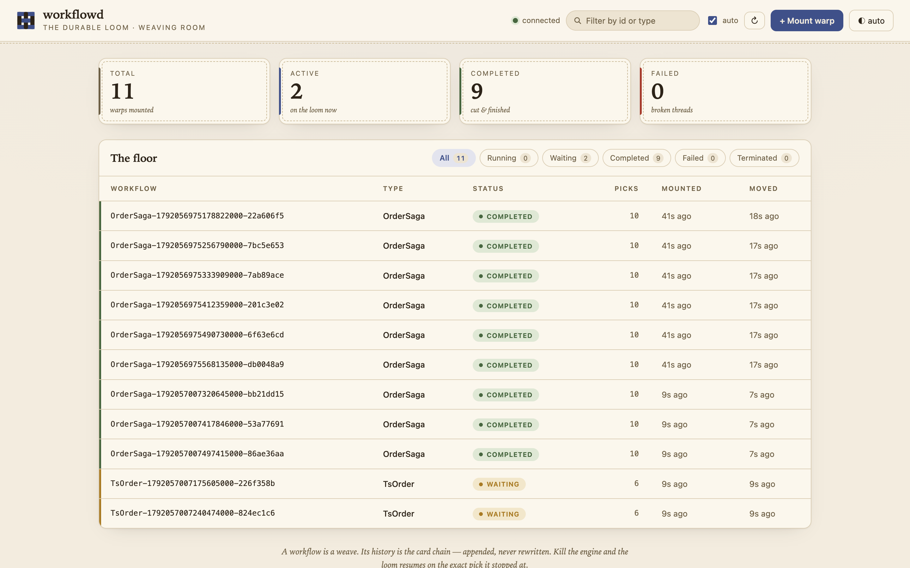

# workflowd

> Durable workflows from a single Go binary. Write ordinary functions in Go, TypeScript or
> Python; workflowd records every step on disk and resumes them exactly where they stopped
> after a crash, a deploy or a week-long sleep. No external database, no Kubernetes.



**Status:** pre-alpha. All five phases of the 17-week [roadmap](docs/ROADMAP.md) are done:
durable history, deterministic replay, timers, signals, retries, Saga compensation, worker
leases, metrics, a dashboard, opt-in Raft replication, and a public Go SDK with versioning and
a test environment. It has not run real production traffic yet; read
[Limitations](#limitations) before you depend on it.

Live demo: [dashboard](https://olayanju-1234.github.io/durable-workflow-engine/demo) ·
[docs](https://olayanju-1234.github.io/durable-workflow-engine/docs.html)

## Quickstart (about 5 minutes)

You need Go 1.26 or newer.

```sh
git clone https://github.com/Olayanju-1234/durable-workflow-engine.git
cd durable-workflow-engine
go run ./cmd/workflowd --serve
```

That is the engine: gRPC on `:7233`, the dashboard and JSON API on `:8233`, metrics on
`:9090`, and histories in `./data`. In a second terminal, run a workflow:

```sh
go run ./examples/hello Ada
```

```
started workflow Greeting-3f9c2a7d1e5b8a40
result: Hello, Ada! 👋
```

Open <http://localhost:8233> to see it: two activities and a durable one-second timer. Then
try the other examples:

| Example | Shows |
|---|---|
| [`examples/hello`](examples/hello) | the smallest complete program: workflow, activities, worker, client |
| [`examples/checkout`](examples/checkout) | a Saga: a manager approval signal, a declined card, compensation |
| [`examples/onboarding`](examples/onboarding) | an email drip over days with durable sleeps and `GetVersion` |

To see durability for yourself, start `go run ./examples/onboarding -day 10s`, stop the engine
with Ctrl-C while the drip is sleeping, and start it again. The worker reconnects, the timer
fires on time, and no email is sent twice.

## A workflow in Go

A workflow is a function. Durable calls go through its `workflow.Context`; everything else is
plain Go.

```go
func Checkout(ctx workflow.Context, order []byte) ([]byte, error) {
	if _, err := ctx.ExecuteActivity("reserve-stock", order); err != nil {
		return nil, err
	}
	// Parks durably until someone sends the signal: seconds or weeks.
	if string(ctx.WaitForSignal("manager-approval", "approval")) != "approve" {
		ctx.ExecuteActivity("release-stock", order)
		return nil, errors.New("rejected")
	}
	receipt, err := ctx.ExecuteActivity("charge-card", order)
	if err != nil {
		ctx.ExecuteActivity("release-stock", order) // compensate
		return nil, fmt.Errorf("payment failed, stock released: %w", err)
	}
	return ctx.ExecuteActivity("ship-order", receipt)
}
```

Activities do the real work, and a worker runs both in your own process:

```go
c, _ := client.Dial(client.Options{Addrs: []string{"localhost:7233"}})
w := worker.New(c, worker.Options{})
w.RegisterWorkflow("Checkout", Checkout)
w.RegisterActivity("charge-card", func(ctx context.Context, order []byte) ([]byte, error) {
	return payments.Charge(ctx, order) // anything: HTTP calls, DB writes, emails
})
// ...register the other activities...
w.Start(ctx)

id, _ := c.StartWorkflow(ctx, "Checkout", order)
c.SignalWorkflow(ctx, id, "approval", []byte("approve"))
result, err := c.WaitForResult(ctx, id)
```

The function runs again from the top on every decision. Completed steps return their recorded
results instantly, so each side effect happens once, but the code must be deterministic: use
`ctx.Now()` instead of `time.Now()`, `ctx.Sleep` instead of `time.Sleep`, and activities for
I/O. The [determinism rules](https://olayanju-1234.github.io/durable-workflow-engine/docs.html#determinism) are short.

### Test it without a server

`testsuite` runs a workflow against mocked activities in virtual time, so a week-long flow
finishes in milliseconds. It replays every decision the way a worker does, so it also catches
non-deterministic code.

```go
env := testsuite.NewEnv()
env.RegisterActivity("reserve-stock", reserve)
env.RegisterActivity("release-stock", release)
env.SignalAfter(7*24*time.Hour, "approval", []byte("reject"))

_, err := env.ExecuteWorkflow(Checkout, order)
// err matches testsuite.ErrWorkflowFailed: "rejected"; env.Elapsed() == 168h
```

### Run steps in parallel, on a schedule, with retries

```go
charge := ctx.ExecuteActivityAsync("charge-card", order,
	workflow.WithRetryPolicy(workflow.RetryPolicy{MaxAttempts: 3, InitialBackoff: time.Second}))
email := ctx.ExecuteActivityAsync("send-receipt", order) // runs at the same time
reply := ctx.WaitForSignalAsync("courier", "picked-up")
if ctx.WaitAny(reply, ctx.NewTimer("sla", 2*time.Hour)) == 1 {
	ctx.ExecuteActivity("escalate", order) // the deadline won the race
}
```

`WaitAny` decides by the order history recorded the results, so a replay always takes the same
branch. A retry policy set on the call is recorded with the step and survives restarts.
Schedules start workflows on a cron expression, durably and on the cluster leader only:

```go
c.CreateSchedule(ctx, client.Schedule{ID: "nightly-report", Cron: "0 2 * * *",
	Timezone: "Europe/London", WorkflowType: "Report"})
```

### Change it safely

Workflows can run for weeks, so code changes while executions are in flight. `GetVersion`
records which branch an execution took, so old executions replay the old branch and new ones
take the new branch:

```go
if ctx.GetVersion("fraud-check", workflow.DefaultVersion, 1) == 1 {
	ctx.ExecuteActivity("fraud-check", order)
}
```

### Packages

| Package | For |
|---|---|
| [`workflow`](workflow) | writing workflow code: `Context`, `GetVersion`, `SideEffect` |
| [`worker`](worker) | running workflows and activities in your process |
| [`client`](client) | starting, signalling, terminating and describing workflows |
| [`testsuite`](testsuite) | unit-testing workflows with mocked activities and virtual time |
| [`embedded`](embedded) | an engine inside your own process, on a local data directory |

The `sdk` package from earlier phases still compiles; it is deprecated in favour of `workflow`
and `worker`. The design is in [ADR-0005](docs/adr/0005-public-go-sdk.md).

## How it works

Every workflow is an append-only history of events in one file, CRC-framed and fsync'd. The
engine runs one loop: **read the history, replay the workflow to find where it is, schedule
the next step, record the result.** Kill the process at any point and, on restart, it re-reads
the files and carries on. Workers are stateless: they poll for tasks, run them, and report
back under a lease, so a dead worker costs a retry, not a stuck workflow. Details in
[`docs/ARCHITECTURE.md`](docs/ARCHITECTURE.md).

## Other languages

The TypeScript and Python SDKs are single files with no dependencies (no npm or pip install)
that use the same workflow-task protocol over HTTP:

```js
worker.workflow('OrderWorkflow', async (ctx) => {
  const reserved = await ctx.activity('reserve', ctx.input);
  await ctx.sleep('settle', 2000); // durable
  try {
    await ctx.activity('charge', reserved);
  } catch (err) {
    await ctx.activity('release', reserved); // compensate
    throw new WorkflowFailure(`charge failed: ${err.message}`);
  }
  return await ctx.activity('ship', reserved);
});
```

| SDK | Status |
|-----|--------|
| Go (`workflow`, `worker`, `client`) | tested end to end, including leader failover |
| TypeScript (`sdks/typescript/`) | run end to end in CI (plaintext and TLS + token); on npm: `npm install workflowd` |
| Python (`sdks/python/`) | run end to end in CI (plaintext and TLS + token); on PyPI: `pip install workflowd` |
| Java (`sdks/java/`) | compiled for Java 11 and run end to end in CI; Maven-ready, not yet published |

Every SDK has retry policies, `getVersion` / `sideEffect`, JSON and binary payloads, and follows
a cluster's leader; TypeScript and Python also run steps in parallel (`Promise.all`,
`ctx.waitAny`, `activity_async`). [`sdks/README.md`](sdks/README.md) describes the protocol if
you want to add a language.

## Running a cluster (optional)

By default workflowd is a single node. Give it peers and it becomes one member of a Raft
cluster: every history write is replicated to a majority before it counts, only the leader
runs the engine, and if the leader dies another node takes over within a couple of seconds.

```sh
make cluster    # three local nodes; see scripts/cluster.sh for the ports
```

Followers answer with the leader's address, and the Go client follows it: give
`client.Options.Addrs` every node. What a cluster guarantees, and what it doesn't, is in
[ADR-0004](docs/adr/0004-replicated-history-leader-only-engine.md).

## Limitations

- **Pre-alpha.** No real production traffic yet; APIs may still change.
- **Auth and TLS are opt-in, and one token.** `--tls-cert`/`--tls-key` and `--auth-token-file`
  cover gRPC, the JSON API and metrics; `--raft-tls-*` gives cluster members mutual TLS. With
  none set, every port is open plaintext, and there are no per-user identities or roles yet.
- **Not load-tested.** Workflows run in parallel under per-workflow locks with their state cached
  in memory, and listing reads an in-memory index; the cost that remains is one fsync per event
  ([ADR-0006](docs/adr/0006-keep-file-per-workflow-store.md)).
- **At-least-once activities.** An activity can run twice if a worker dies after doing the work
  but before reporting it. Make activities idempotent (`worker.GetActivityInfo` gives a key).
  Signals are exactly-once: each carries an idempotency key.
- **Rolling back** to an older binary: binaries before the version markers can't read histories
  that contain one, and binaries before parallel steps can't read histories that ran some.

## Project layout

```
cmd/workflowd/      the daemon
workflow/ worker/ client/ testsuite/ embedded/   the public Go SDK
examples/           three runnable examples, each tested in CI
internal/history/   append-only event store, the source of truth
internal/state/     reconstruct state from history; data-driven decisions
internal/replay/    the Go replay engine (shared by worker, engine, testsuite)
internal/server/    engine, task queues, leases, retries, gRPC + HTTP APIs
internal/raft/      consensus: elections, replication, snapshots
internal/cluster/   replicated history + leader-only engine
internal/timer/ internal/metrics/ internal/record/ internal/rpc/
sdks/               TypeScript, Python and Java SDKs
web/                embedded dashboard and the public site
proto/              protobuf definitions
docs/               architecture, roadmap, ADRs, session walkthroughs
```

## Development

```sh
make ci       # gofmt check, vet, build, tests under -race (what CI runs)
make proto    # after editing proto/*.proto (needs protoc)
```

See [`CONTRIBUTING.md`](CONTRIBUTING.md). Session notes and design decisions are in
[`docs/`](docs).

## License

[Apache-2.0](LICENSE).
