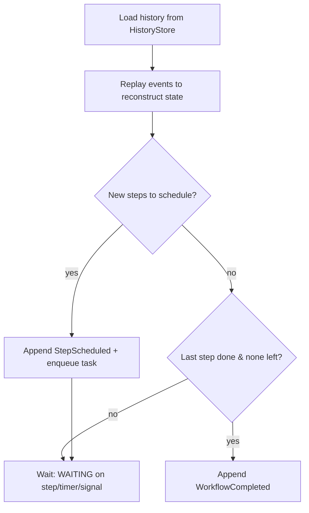

# Architecture

> The entire engine rests on one idea: **every workflow is a sequence of events in an
> append-only history.** One event says "step X was scheduled," another says "step X
> completed with result Y." The engine is a loop: read history, replay to find the
> current position, schedule the next step, record the result. Everything else is
> engineering on top of that loop.

## Components

| Component | Package | Phase | Responsibility |
|-----------|---------|-------|----------------|
| **History Store** | `internal/history` | 1 | Append-only event log per workflow. CRC32-framed, fsync'd. The single source of truth for all state. |
| **State Machine** | `internal/state` | 1 | Walks a workflow's history to reconstruct state and emit *decisions* (schedule step, complete, fail). Pure function of history. |
| **gRPC Task Queue** | `internal/server` | 1 | Public API: `StartWorkflow`, `PollTask`, `CompleteTask`. Bridges engine ↔ external workers. |
| **Timers & Signals** | `internal/timer` | 2 | Min-heap of fire times; background goroutine appends `TimerFired`. External `SignalWorkflow` to park/resume workflows. |
| **Replay Engine** | `internal/replay` | 2, 5 | Re-executes workflow code, returning recorded outputs for already-completed steps so side effects never repeat. Requires deterministic workflows. Shared by the in-process engine, the Go worker and the test environment. |
| **Scheduler** | `internal/server` | 3 | Worker identity, a lease token per dispatched step (workflow + sequence), `Heartbeat` RPC, reassignment on lease expiry (a dead worker's task is retried per policy). No sticky queues: see "Why no sticky queues" below. |
| **Concurrency + cache** | `internal/server` (`wfstate.go`, `index.go`) | backlog | A lock and an in-memory history + replayed state per workflow (folded event by event), and a visibility index for listing. See "Concurrency, caching and the index". |
| **Schedules** | `internal/cron`, `internal/server` | backlog | Cron schedules that start workflows, stored in a reserved history and fired by the leader. See "Schedules". |
| **Consensus (Raft)** | `internal/raft` | 4 | Leader election (Wk11), log replication, snapshotting. All history writes go through the Raft log for HA. See "Replication (Raft)" below. |
| **Polyglot protocol** | `internal/server` | 3+ | `RegisterWorkflowType` / `PollWorkflowTask` / `CompleteWorkflowTask`: workflow code runs in an SDK process and returns the commands it issued before blocking (several, for parallel steps). |
| **Public Go SDK** | `workflow`, `worker`, `client`, `testsuite`, `embedded` | 5 | What Go developers import: write workflows, run them in their own process over gRPC, start and inspect them, unit-test them in virtual time, or embed an engine. See "The Go SDK" below and [ADR-0005](adr/0005-public-go-sdk.md). |

## Data flow (happy path)

```
client ──StartWorkflow──▶ engine
                           │  append WorkflowStarted
                           │  replay history ▶ decide: schedule step 1
                           │  append StepScheduled, enqueue task
worker  ──PollTask──────▶ engine ──▶ task(step 1, input)
worker  (executes step)
worker  ──CompleteTask──▶ engine
                           │  append StepCompleted
                           │  replay history ▶ decide: schedule step 2 ... or complete
                           ▼
                    (repeat until WorkflowCompleted / WorkflowFailed)
```

On crash + restart, the engine scans the data dir, re-reads each history file, replays the
decision loop, and re-enqueues any step that was scheduled but never completed. Because
history is the source of truth, **recovery is just replaying the decision loop.** No
duplicate execution, no lost state.

## The decision loop



States: `RUNNING`, `WAITING`, `COMPLETED`, `FAILED`, `TIMED_OUT`.

## On-disk record format (history store)

Each workflow execution gets its own append-only file: `<dataDir>/<workflowID>.history`.
Records are appended and fsync'd one at a time:

```
┌───────────┬───────────────┬───────────────────────────┐
│ 4B length │ 4B CRC32C      │ N-byte protobuf HistoryEvent │
│ (BE u32)  │ (of payload)   │                           │
└───────────┴───────────────┴───────────────────────────┘
```

- **Length prefix** → sequential reads without delimiters.
- **CRC32C** → detects bit rot / torn writes. A CRC mismatch on a complete record is a hard
  error; a short read (torn header/payload from a crash mid-append) is treated as end-of-log.
- **fsync per append** → an event is only "committed" once durable. Correctness over
  performance; in a cluster the Raft log is fsync'd per batch instead. The store holds no
  lock across a write, fsync or read, so different workflows' fsyncs overlap.
- **Event types** grow by adding `oneof` fields (`MarkerRecordedEvent` arrived in Phase 5),
  and events grow optional fields (`retry_policy`, `will_retry`, a signal's `request_id`).
  An older binary cannot read a history that contains a newer event type, or one with
  several steps in flight.
- **Staying on files** was revisited with measurements in
  [ADR-0006](adr/0006-keep-file-per-workflow-store.md): no LSM engine.
- **Torn-tail truncation on open** → the append handle is cached per workflow, and opening it
  truncates any partial trailing record. A failed write or fsync drops the cached handle, so
  a live process recovers on its next append the same way a restarted one does.

See [ADR-0001](adr/0001-record-format.md). Protobuf rationale: [ADR-0002](adr/0002-protobuf-events.md).

## Replication (Raft)

Opt-in with `--node-id` and `--peers`; without them the daemon is single-node and
none of this runs. The Raft implementation in `internal/raft` has three layers:

- **core**: the algorithm as a deterministic state machine. Inputs are `tick()`
  and `step(message)`; the output is a `Ready` batch (state to persist, messages
  to send). No clock, disk or network, so tests replay exact schedules.
- **Node**: one goroutine that owns the core, turns wall-clock time into ticks,
  and persists every `Ready` (fsync) **before** sending its messages.
- **Transport**: `RaftService.Send(Envelope)`, one one-way gRPC call per Raft
  message (responses are messages too). Peer traffic has its own listener
  (`--raft-addr`) and must never be exposed publicly.

Elections use randomized timeouts (1–2 s by default), one durable vote per term,
the paper's up-to-date log check, CheckQuorum (a leader that can't hear a
majority steps down) and §6 vote suppression. Durable Raft state lives in
`<data-dir>/raft/` (`hardstate`, `log`), framed like the histories
(`internal/record`).

Replication: the leader appends proposals to its log and sends each follower
what it is missing in `AppendEntries`, guarded by the prevLogIndex/prevLogTerm
check (followers truncate only at a real conflict). Sending is pipelined with
flow control: the leader moves a follower's `next` past what it sent (a lost
message shows up as a rejection of the next one) and keeps at most 1024
unacknowledged entries in flight per follower. An entry commits once a
majority holds it on disk, counting only entries from the leader's own term; a
new leader therefore opens its term with an empty entry. Each node's `Node`
persists (hard state, then entries) before sending, and applies committed
entries on a separate goroutine. `Node.Propose(ctx, term, data)` is fenced by
term and returns the state machine's result once the entry is applied locally.

Snapshots: every `SnapshotEvery` applied entries a node serializes its state
machine, writes `raft/snapshot` (atomically) and only then rewrites the log
without the covered entries. A follower that needs entries the leader has
compacted gets an `InstallSnapshot`; it keeps its log if it already holds the
snapshot's last entry, and otherwise replaces log and state with the snapshot.

Testing: `sim_test.go` runs whole clusters in memory with no clock, goroutines or
sockets, and a checker of the five Raft safety properties runs against 200
seeded random failure schedules. Testing knobs that switch off one rule each
prove the checker can fail.

### The engine on Raft (`internal/cluster`, ADR-0004)

```
client ──▶ any node ──▶ follower?  ─▶ 503 / Unavailable + leader hint
                    └─▶ leader ─▶ Engine (this term's) ─▶ HistoryLog.Append
                                                         │ propose Command (term-fenced)
                                       Raft log ◀────────┘ commit on a majority
                                         │ apply on every node
                                         ▼
                              history store (<id>.history, raft_index stamps)
```

- **What is replicated:** history mutations (`AppendEvent`, `DeleteWorkflow`), the
  engine's outputs. Followers never run workflow logic.
- **State machine:** each node's history directory. Apply stamps each event with
  its Raft index (idempotent replay after restart) and accepts it only at the next
  event id (a deterministic fence). Files are written without fsync; the Raft log
  is the write-ahead log, and `Sync` runs before a snapshot marks them durable.
- **Leader-only engine:** a fresh `Engine` per term, built once the leader has
  applied its term's opening entry, then `Recover()`: a leader change is a restart
  elsewhere. Lost leadership closes the engine; pending writes fail.
- **Routing:** `EngineSource` resolves the engine per call; followers answer with
  the leader's id and client addresses (learned from metadata on Raft traffic).
- **Snapshots:** the raw bytes of every history file in `internal/record` frames.

## The Go SDK (Phase 5, ADR-0005)

```
your process                                         workflowd
──────────────────────────────────────               ─────────────────────────
client.StartWorkflow ─────────── gRPC ──────────────▶ append WorkflowStarted
worker ─ RegisterWorkflowType ───────────────────────▶ type → remote planner
worker ─ PollWorkflowTask ◀── task: full history ──── dispatch decision
  replay.DecideAll(fn, history)  (internal/replay)
worker ─ CompleteWorkflowTask(commands) ─────────────▶ validate, fence, append
worker ─ PollTask(step_names) ◀── activity task ───── lease + enqueue
  run ActivityFunc, Heartbeat every lease/3
worker ─ CompleteTask(output | error) ───────────────▶ append, decide again
```

- **One replay engine.** `internal/replay` runs a `workflow.Func` against a history and
  returns the next decision. The engine uses it in-process for the daemon's own demo
  workflows, the worker uses it for tasks it polls, and `testsuite` uses it against an
  in-memory history, so all three behave identically.
- **Suspension can't be caught.** Each decision runs the function on its own goroutine.
  When a durable call reaches the first step history has no result for, the context
  records the decision and calls `runtime.Goexit()`, which `recover()` in workflow code
  cannot stop. A panic in workflow code becomes a replay error and fails the workflow.
- **Markers.** `GetVersion` and `SideEffect` record a `MarkerRecordedEvent`: a step that
  completes as it is recorded, with no worker. A version marker stores which branch an
  execution took; an execution with no marker at that point predates the change and gets
  `DefaultVersion`, without consuming a step sequence, so its old history still lines up.
- **Following the leader.** `internal/rpc` keeps a gRPC connection per known node. A
  `workflowd-leader-grpc` trailer on `Unavailable` moves calls to the leader; without one,
  calls rotate through the known nodes with a short backoff. Every time a call is turned
  away the worker registers its workflow types again, because each new engine (restart,
  new leader, new term) starts with none.
- **Steps don't wait for registration.** Recovery, timers, signals and activity results
  are recorded whether or not the workflow's type is registered; only the next decision
  waits for a worker to register it.

## Concurrency, caching and the index

```
op on workflow W ─▶ lock W ─▶ cached events + state (Folder) ─▶ decide ─▶ HistoryLog.Append
                                   ▲ fold the new event in ◀────────────────┘
                                   └─▶ visibility index: W's summary
```

- **Per-workflow locks.** Everything that reads a workflow's history and then appends to it
  holds that workflow's lock, so its event ids stay contiguous; other workflows run in
  parallel. `Engine.mu` guards only shared maps (planners, policies, leases, pending
  decisions) and is never held across I/O. Order: a workflow's lock, then `Engine.mu`.
- **The cache.** A workflow in use keeps its events and replayed state; `state.Folder` is
  `Reconstruct` one event at a time, so an append costs O(1), not a re-read and re-replay
  (a 1000-step workflow went from 2.25 ms to 49 µs a step). Idle unfinished workflows are
  kept LRU (`WithStateCacheSize`); finished ones leave at once. The engine is the only
  writer of its histories, so the cache stays in step. **A failed append drops the cached
  copy**: the write may have landed, so the next operation reads the file.
- **The visibility index.** One summary per workflow, built by `Recover` in its existing
  pass and updated on every append (under the workflow's lock) and purge. Listing,
  retention and SDK-registration resume read it instead of scanning the data directory
  (10k workflows: 734 ms to 0.75 ms). A write whose outcome is unknown marks the entry
  stale and the next listing re-reads it.
- Ids starting with `__workflowd` are reserved for engine-internal histories.

## Parallel steps ([ADR-0007](adr/0007-parallel-steps.md))

- History may have several steps in flight; results name their step by sequence; a retry
  re-opens its own sequence. A failure the engine will retry is recorded with
  `will_retry` and stays open to workflow code.
- The engine decides after **every** step result, even with other steps in flight, and
  applies the batch the planner returns (`CompleteWorkflowTask.commands`). Recovery
  re-dispatches every open step, re-arms every retry, and decides if the last event was a
  result.
- "First of" races (`WaitAny`) pick the step whose result history recorded first
  (`ResolvedEventID`), so every replay agrees.

## Schedules

```
CreateSchedule ─▶ __workflowd-schedules history: WorkflowStarted, SignalReceived(upsert|delete)…
timer (leader's engine) ─▶ StartWorkflow("<id>-<fire time>")  ← AlreadyExists = already fired
Recover ─▶ load schedules ─▶ start the latest fire missed in 24 h ─▶ arm the next
```

Schedules are a workflow-shaped history of existing event types, so they replicate through
Raft like any history and every binary can read the data directory. Only an engine fires
them, and in a cluster only the leader runs one. The run id names the fire time, which makes
firing idempotent across restarts and failovers. Cron parsing is hand-written
(`internal/cron`): five fields, names, ranges, steps, macros, `@every`, time zones, DST.

## Exactly-once signals

`SignalWorkflow` carries an optional `request_id`, recorded on the `SignalReceived` event. A
signal whose key is already in the history succeeds without being recorded again, even after
the workflow finished and on a new leader (the key replicates with the history). The Go client
makes one key per call and reuses it on every retry; the HTTP SDKs send one per signal.

## Why no sticky queues

Temporal's sticky queues route a workflow's tasks back to the worker that holds it in memory,
so the worker resumes the paused function instead of replaying it. workflowd has nothing to
stick to: workers are stateless, and every task carries the full history. Measured replay cost
per decision (`internal/replay` `BenchmarkReplayDecision`): 21 µs at 10 steps, 74 µs at 100
(4.8 KB of history), 0.7 ms at 1000 (52 KB). That is at or below one network round trip for
the task itself, and the engine side is already cached. Sticky execution would add a worker
cache, routing, a sticky timeout and failover handling to save that. Not built; revisit for
workflows with many thousands of steps, where a continue-as-new (restart with fresh history)
is the better tool anyway.

## Auth and TLS (opt-in)

Every listener is plaintext and open unless flags say otherwise, so existing
deployments are unchanged. `internal/tlsconfig` builds the `*tls.Config`s: `Server`
for the client-facing ports and `Peer` for Raft (mutual TLS, usable on both ends of a
connection: it demands a client certificate from the CA and presents its own). Both
re-read the certificate when its file's mtime changes and keep the last good one if a
renewal is half-written.

| Listener | TLS | Auth |
|---|---|---|
| gRPC | `--tls-cert/--tls-key` | `server.GRPCAuth`: unary + stream interceptors check `authorization: Bearer` metadata |
| JSON API + dashboard | same cert | `HTTPAPI.requireAuth`: every `/api` route but health; `WithPublicReads` opens list/describe only |
| Metrics | same cert | `server.BearerAuth` with its own token |
| Raft | `--raft-tls-*` (mTLS) | the peer certificate |

Tokens come from a file or an environment variable (`cmd/workflowd/security.go`); the
argv flag still works but warns. One token covers HTTP and gRPC, compared in constant
time. Polls (`/api/workflow-tasks`, `/api/activity-tasks`, `PollTask`) lease work, so
they are never "reads". Clients: `client.Options{TLS, AuthToken}` in Go (a per-RPC
credential allowed over plaintext, for TLS-terminating proxies), and a `token` option
plus an https address in the TypeScript, Python and Java SDKs.

## Determinism

Replay only works if workflow functions are deterministic: same history, same sequence of
durable calls. The Go SDK provides the replacements:

- `time.Now()` → `ctx.Now()`: the time of the latest event the code has replayed past, in UTC.
- `time.Sleep` → `ctx.Sleep`: a durable timer recorded in history.
- `rand`, UUIDs, reading config that may change → `ctx.SideEffect`: run once, recorded.
- Changing the code while executions are in flight → `ctx.GetVersion`.
- No goroutines, file or network I/O in workflow code; do it in activities.

A workflow that issues a different step than history recorded fails with a non-determinism
error rather than corrupting the execution. `testsuite` replays every decision, so tests
catch this before a deploy does.

## Key concepts this design exercises

Append-only logs · write-ahead logging · deterministic replay · state machines · consensus
(Raft) · gRPC/protobuf · priority-queue scheduling · Saga/compensation · lease tokens &
heartbeat liveness · backpressure. See `docs/REFERENCES.md`.
