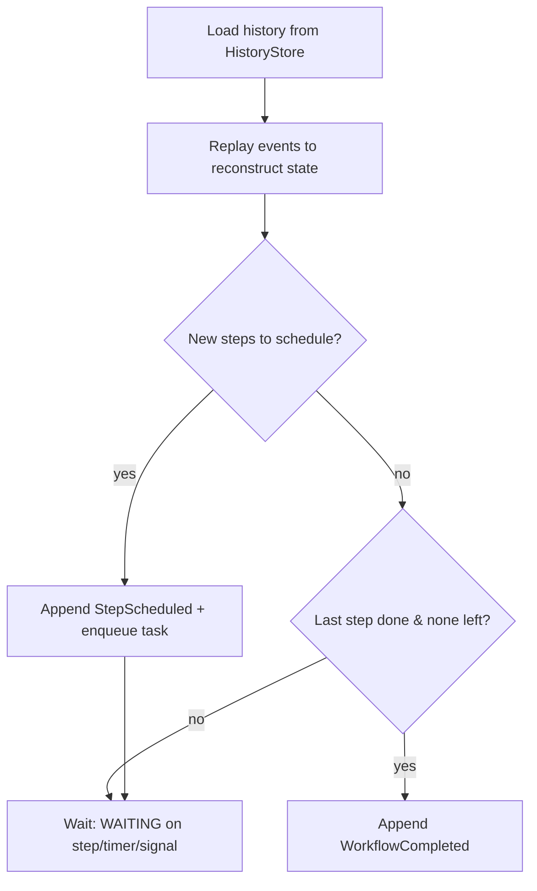

# Architecture

> The entire engine rests on one idea: **every workflow is a sequence of events in an
> append-only history.** One event says "step X was scheduled," another says "step X
> completed with result Y." The engine is a loop: read history, replay to find the
> current position, schedule the next step, record the result. Everything else is
> engineering on top of that loop.

## Components

| Component | Package | Phase | Responsibility |
|-----------|---------|-------|----------------|
| **History Store** | `internal/history` | 1 | Append-only event log per workflow. CRC32-framed, fsync'd. The single source of truth for all state. |
| **State Machine** | `internal/state` | 1 | Walks a workflow's history to reconstruct state and emit *decisions* (schedule step, complete, fail). Pure function of history. |
| **gRPC Task Queue** | `internal/server` | 1 | Public API: `StartWorkflow`, `PollTask`, `CompleteTask`. Bridges engine ↔ external workers. |
| **Timers & Signals** | `internal/timer` | 2 | Min-heap of fire times; background goroutine appends `TimerFired`. External `SignalWorkflow` to park/resume workflows. |
| **Replay Engine** | `sdk` + engine | 2 | Re-executes workflow code, returning recorded outputs for already-completed steps so side effects never repeat. Requires deterministic workflows. |
| **Scheduler** | `internal/server` | 3 | Worker identity, lease tokens on every dispatched task, `Heartbeat` RPC, reassignment on lease expiry (a dead worker's task is retried per policy). Sticky queues deferred — workers are stateless activity executors, so there is no worker-side cache to stick to yet. |
| **Consensus (Raft)** | `internal/raft` | 4 | Leader election (Wk11), log replication, snapshotting. All history writes go through the Raft log for HA. See "Replication (Raft)" below. |
| **Public SDK** | `sdk` | 5 | The Go package developers import. `workflow.Execute/Sleep/WaitForEvent/...`, `client.*`, `worker.New`. |

## Data flow (happy path)

```
client ──StartWorkflow──▶ engine
                           │  append WorkflowStarted
                           │  replay history ▶ decide: schedule step 1
                           │  append StepScheduled, enqueue task
worker  ──PollTask──────▶ engine ──▶ task(step 1, input)
worker  (executes step)
worker  ──CompleteTask──▶ engine
                           │  append StepCompleted
                           │  replay history ▶ decide: schedule step 2 ... or complete
                           ▼
                    (repeat until WorkflowCompleted / WorkflowFailed)
```

On crash + restart, the engine scans the data dir, re-reads each history file, replays the
decision loop, and re-enqueues any step that was scheduled but never completed. Because
history is the source of truth, **recovery is just replaying the decision loop.** No
duplicate execution, no lost state.

## The decision loop



States: `RUNNING`, `WAITING`, `COMPLETED`, `FAILED`, `TIMED_OUT`.

## On-disk record format (history store)

Each workflow execution gets its own append-only file: `<dataDir>/<workflowID>.history`.
Records are appended and fsync'd one at a time:

```
┌───────────┬───────────────┬───────────────────────────┐
│ 4B length │ 4B CRC32C      │ N-byte protobuf HistoryEvent │
│ (BE u32)  │ (of payload)   │                           │
└───────────┴───────────────┴───────────────────────────┘
```

- **Length prefix** → sequential reads without delimiters.
- **CRC32C** → detects bit rot / torn writes. A CRC mismatch on a complete record is a hard
  error; a short read (torn header/payload from a crash mid-append) is treated as end-of-log.
- **fsync per append** → an event is only "committed" once durable. Correctness over
  performance for now; Phase 4 batches writes to amortize fsync.
- **Torn-tail truncation on open** → the append handle is cached per workflow, and opening it
  truncates any partial trailing record. A failed write or fsync drops the cached handle, so
  a live process recovers on its next append the same way a restarted one does.

See [ADR-0001](adr/0001-record-format.md). Protobuf rationale: [ADR-0002](adr/0002-protobuf-events.md).

## Replication (Raft)

Opt-in with `--node-id` and `--peers`; without them the daemon is single-node and
none of this runs. The Raft implementation in `internal/raft` has three layers:

- **core**: the algorithm as a deterministic state machine. Inputs are `tick()`
  and `step(message)`; the output is a `Ready` batch (state to persist, messages
  to send). No clock, disk or network, so tests replay exact schedules.
- **Node**: one goroutine that owns the core, turns wall-clock time into ticks,
  and persists every `Ready` (fsync) **before** sending its messages.
- **Transport**: `RaftService.Send(Envelope)`, one one-way gRPC call per Raft
  message (responses are messages too). Peer traffic has its own listener
  (`--raft-addr`) and must never be exposed publicly.

Elections use randomized timeouts (1–2 s by default), one durable vote per term,
the paper's up-to-date log check, CheckQuorum (a leader that can't hear a
majority steps down) and §6 vote suppression. Durable Raft state lives in
`<data-dir>/raft/` (`hardstate`, `log`), framed like the histories
(`internal/record`).

Replication: the leader appends proposals to its log and sends each follower
what it is missing in `AppendEntries`, guarded by the prevLogIndex/prevLogTerm
check (followers truncate only at a real conflict). An entry commits once a
majority holds it on disk, counting only entries from the leader's own term; a
new leader therefore opens its term with an empty entry. Each node's `Node`
persists (hard state, then entries) before sending, and applies committed
entries on a separate goroutine. `Node.Propose(ctx, term, data)` is fenced by
term and returns the state machine's result once the entry is applied locally.

## Determinism (Phase 2+)

Replay only works if workflow functions are deterministic: same inputs → same step
sequence. The SDK forbids non-determinism and provides replacements:

- ❌ `time.Now()` → ✅ `workflow.Now(ctx)` (recorded time)
- ❌ `rand` → ✅ `workflow.Random(ctx)` (deterministic seed)
- ❌ bare `go func()` → ✅ `workflow.Go(ctx, fn)` (tracked in history)

## Key concepts this design exercises

Append-only logs · write-ahead logging · deterministic replay · state machines · consensus
(Raft) · gRPC/protobuf · priority-queue scheduling · Saga/compensation · lease tokens &
heartbeat liveness · backpressure. See `docs/REFERENCES.md`.
